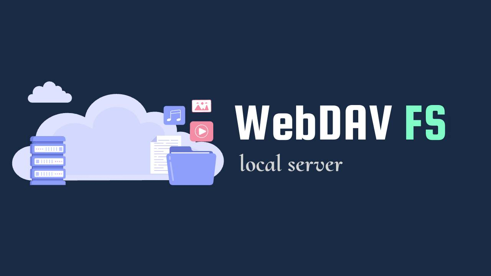
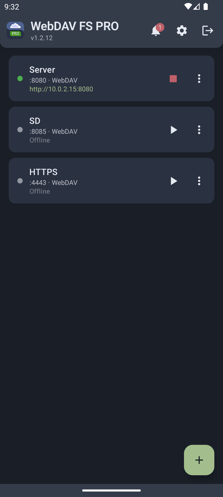
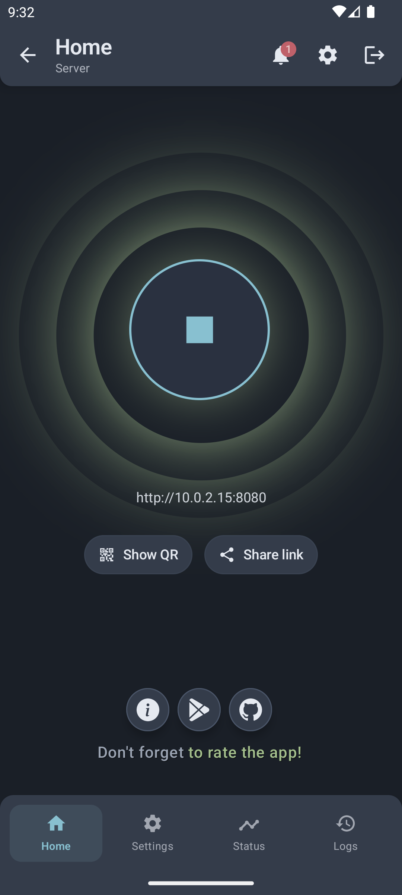
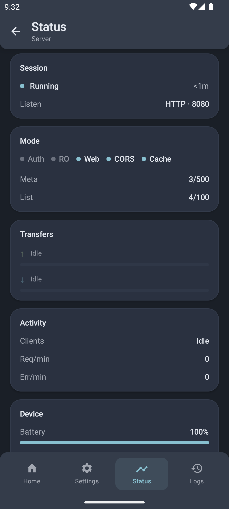
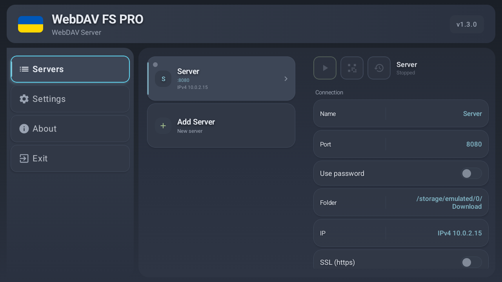
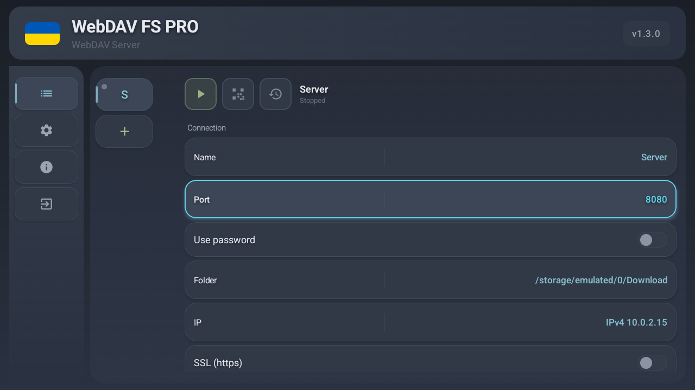

[![Issues][issues-shield]][issues-url] ![Version][version-shield] [![Android][android-shield]][gp-url] [![LinkedIn][linkedin-shield]][linkedin-url] [![DeepWiki][deepwiki-shield]][deepwiki-url]

# [WebDAV FS - Android App](https://tiarait.github.io/WebDav-FS-Intro/)

WebDAV FS is a fast, simple and secure application that provides a WebDAV (and optional FTP) server on your device.

With this application you can set any directory on your phone — including memory cards — as a drive for Windows or Linux. Run one server or several at once (for example, internal storage and an SD card on different ports).

There is support for HTTPS, a built-in browser file manager, Android TV, and Free / Pro editions.

  

  

## About

WebDAV FS turns an Android phone, tablet, or TV into a **local file server**. Other devices on the same network can browse, copy, and manage files on your device.

Configure each server with its own port, shared folder (or users), password / read-only access, and optional SSL. Start servers manually, with the app, or after boot. Theme and language follow your preferences.

Whether you need a quick share on home Wi‑Fi or a more locked-down setup with HTTPS and accounts, WebDAV FS keeps the flow simple and customizable.

## Features

The Android app lets you:

- Run one or more **WebDAV** servers on the local network (Free: up to **2**; Pro: no fixed app limit)
- Optional **FTP** mode per server
- **HTTPS** with Auto / Import / Let's Encrypt (ACME) certificates
- Built-in **web file manager** (thumbnails, ZIP helpers, and more)
- Strong WebDAV support for capable clients — core **RFC 4918**, quota (**RFC 4331**), sync-collection (**RFC 6578**), conditional requests (**RFC 7232**), locks, ranges / partial uploads
- Password / **Users** (roles, folders, optional quotas) and read-only mode
- **Status** metrics and **Logs** in the app; start with app or device
- Folder picker with Quick Access shortcuts; SD card / SAF access
- Themes, languages, and **Android TV** UI
- Free edition includes ads (session disable via rewarded video); Pro unlocks extras such as custom headers and hidden-file tools

## User Help

- [Information about available settings in the application](https://tiarait.github.io/WebDav-FS-Intro/help.html)
- In-repo guide for DeepWiki and end users: [`docs_ai/`](docs_ai/README.md) — start with the [user guide](docs_ai/user/guide.md) or [WebDAV capabilities](docs_ai/features/webdav-capabilities.md)
- Ask questions on [DeepWiki](https://deepwiki.com/Tiarait/WebDav-FS)

## Screenshots

| | |
| --- | --- |
|  |  |
|  | |
|  |  |

## License

WebDAV FS is released under the [Apache-2.0](LICENSE).

[linkedin-url]: https://linkedin.com/in/tiarait
[linkedin-shield]: https://img.shields.io/badge/-LinkedIn-black.svg?style=for-the-badge&logo=linkedin&colorB=555
[issues-shield]: https://img.shields.io/github/issues/Tiarait/WebDav-FS.svg?style=for-the-badge
[issues-url]: https://github.com/Tiarait/WebDav-FS/issues
[version-shield]: https://img.shields.io/badge/Version-1.3.0-blue?style=for-the-badge
[gp-url]: https://play.google.com/store/apps/details?id=ua.tiar.webdavfs

[android-shield]: https://img.shields.io/badge/Android-5.0+-green?style=for-the-badge

[deepwiki-url]: https://deepwiki.com/Tiarait/WebDav-FS
[deepwiki-shield]: https://img.shields.io/badge/ASK-DeepWiki-blue?style=for-the-badge
